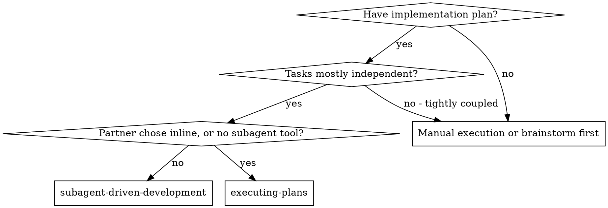
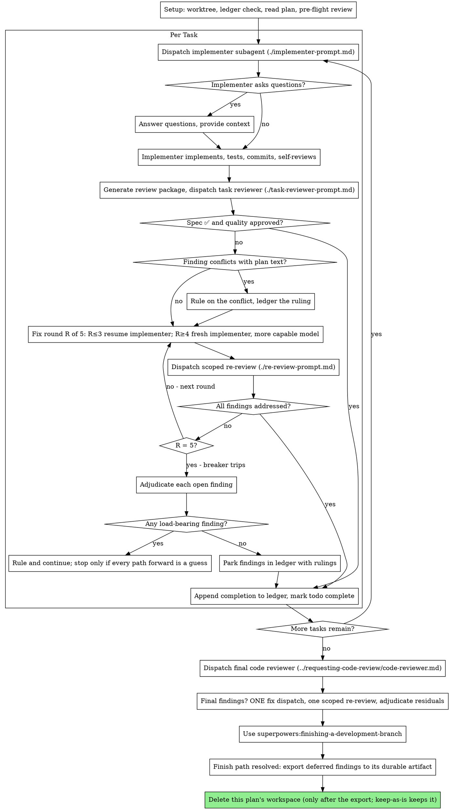

# Subagent-Driven Development

Execute plan by dispatching a fresh implementer subagent per task, a task review (spec compliance + code quality) after each, and a broad whole-branch review at the end.

**Why subagents:** You delegate tasks to specialized agents with isolated context. By precisely crafting their instructions and context, you ensure they stay focused and succeed at their task. They should never inherit your session's context or history — you construct exactly what they need. This also preserves your own context for coordination work.

**Core principle:** Fresh subagent per task + task review (spec + quality) + broad final review = high quality, fast iteration

**Narration:** at most one short line between tool calls.

**Continuous execution:** Do not pause to check in with your human partner between tasks. Execute all tasks from the plan without stopping. The only reasons to stop are the four named below, or all tasks complete. "Should I continue?" prompts and progress summaries waste their time — they asked you to execute the plan, so execute it.

**Rulings, not stalls.** A running plan does not wait on a human. Conflicts,
ambiguities, plan defects, a cap you would have asked to exceed — decide
them. The spec is the binding authority, the plan is its argument, and your
judgment settles what neither answers. Record every decision in the ledger as
`Ruling: <what you decided> — <why> — <what it costs if wrong>`, and keep
going. A wrong ruling costs rework your human partner can see and undo; a
session parked on a question costs their whole day and buys nothing.

Four things stop you, and only these: an irreversible or destructive
operation; a security-sensitive action; a side effect outside this worktree
that norms say you ask about first (a merge, a push to a shared branch, a
publish); and a plan so broken that every path forward is a guess. For those,
stop and ask.

## When to Use

**vs. Executing Plans (inline):**
- Fresh subagent per task and a review after each, instead of one context and one final review
- Costs a fresh context per task and per review
- Both run in this session, share the plan workspace and ledger, and never pause between tasks

## The Process

## Setup

Work in an isolated workspace: use superpowers:using-git-worktrees to create
one or verify the existing one. Never start on a main/master branch without
your human partner's explicit consent.

Conversation memory does not survive compaction. Controllers that lost their
place have re-dispatched entire completed task sequences — the single most
expensive failure observed. Track progress in a ledger file, not only todos.

- At skill start, run this skill's `bash scripts/sdd-workspace PLAN_FILE`
  (or `scripts/sdd-workspace.ps1 PLAN_FILE` on Windows PowerShell) by its
  absolute path, from the working tree you're executing in — it prints the
  plan's git-ignored directory (under `<repo-root>/.superpowers/sdd/`), home to
  every artifact for THIS plan: ledger, briefs, reports, review packages.
  Another plan's directory is never yours to read or write.
- The ledger lives at `<workspace>/progress.md`; its first line is
  `# SDD ledger — plan: <plan file path>`. After compaction, trust the ledger
  and `git log` over your own recollection.

Before dispatching Task 1, read [references/setup.md](references/setup.md):
it holds the resume rules, ledger and Discoveries format, the helpers'
working-tree rules, and the pre-flight conflict scan you must run and ledger.

## Model Selection

Use the least powerful model that can handle each role. **Always specify the
model explicitly when dispatching a subagent** — an omitted model inherits
your session's, which silently defeats this section. Follow a task's
**Tier:** field when it has one. Dispatch the final whole-branch review on the
most capable available model. Read [references/model-selection.md](references/model-selection.md)
before the first dispatch of each role.

## The Task Loop

Hand artifacts over as files: everything you paste into a dispatch prompt, and
everything a subagent prints back, stays resident in your context. Read
[references/batching.md](references/batching.md) before the first dispatch for
when to batch small same-shape work and how to wait on subagents.

### 1. Dispatch the implementer

Record BASE (`git rev-parse HEAD`) before dispatching — the review package
and fix-round diffs need it.

- **Task brief:** before dispatching an implementer, run this skill's
  `bash scripts/task-brief PLAN_FILE TASK_ID` (or `scripts/task-brief.ps1 PLAN_FILE TASK_ID` on
  Windows PowerShell) by its absolute path, from the working tree you're
  executing in — it extracts the task's full text to a uniquely named file
  and prints the path. Compose the dispatch so the
  brief stays the single source of
  requirements. Your dispatch should contain: (1) one line on where this
  task fits in the project; (2) the brief path, introduced as "read this
  first — it is your requirements, with the exact values to use verbatim";
  (3) interfaces and decisions from earlier tasks that the brief cannot
  know — read them from the ledger's Discoveries section, not from your
  memory of past reports: copy the entries the task's interfaces touch, in
  full, and skip the rest; (4) your resolution of any ambiguity you noticed
  in the brief; (5) the report-file path and report contract. Exact values
  (numbers, magic strings, signatures, test cases) appear only in the
  brief. Never
  make a subagent read the whole plan file. When the brief is a contract
  rather than written-out code, see references/dispatch.md for what item (3) adds.
- **Report file:** name the implementer's report file after the brief
  (brief `…/task-N-brief.md` → report `…/task-N-report.md`) and put it in
  the dispatch prompt. The implementer writes the full report there and
  returns only status, commits, a one-line test summary, and concerns.
- Before composing the dispatch, read [references/dispatch.md](references/dispatch.md):
  one task per prompt (no pasted history), the no-subagents contract, parked-finding
  pointers, recording the implementer's identity, and the concurrent-wave exception
  (never dispatch implementers in parallel otherwise).

Template: [implementer-prompt.md](implementer-prompt.md)

### 2. Handle the report

Implementer subagents report one of four statuses: DONE, DONE_WITH_CONCERNS,
NEEDS_CONTEXT, BLOCKED. Read [references/handling-reports.md](references/handling-reports.md)
for anything other than a plain DONE; never ignore an escalation or force the
same model to retry unchanged.

**DONE:** Generate the review package (`bash scripts/review-package PLAN_FILE BASE HEAD`, or `scripts/review-package.ps1 PLAN_FILE BASE HEAD` on Windows PowerShell) by its absolute path, from the working tree you're executing in — it prints the unique file path it wrote; BASE is the commit you recorded before dispatching the implementer — never `HEAD~1`, which silently drops all but the last commit of a multi-commit task. Then dispatch the task reviewer with the printed path.

### 3. Review the task

Per-task reviews are task-scoped gates. The broad review happens once, at the
final whole-branch review. Never skip the task review, and never accept a
report missing either verdict — spec compliance AND task quality are both
required. Implementer self-review never replaces the task review; both are
needed.

- Hand the reviewer its diff as a file: run this skill's
  `bash scripts/review-package PLAN_FILE BASE HEAD` (or
  `scripts/review-package.ps1 PLAN_FILE BASE HEAD` on Windows PowerShell) by
  its absolute path, from the working tree you're executing in, and pass the
  reviewer the file path
  it prints (or, without bash: `git log --oneline`, `git diff --stat`,
  and `git diff -U10` for the range, redirected to one uniquely named
  file). The output never enters your own context, and the reviewer sees
  the commit list, stat summary, and full diff with context in one Read
  call. Use the BASE you recorded before dispatching the implementer —
  never `HEAD~1`, which silently truncates multi-commit tasks. Never
  dispatch a task reviewer without a diff file.
- **Reviewer inputs:** the task reviewer gets four paths — the same brief
  file, the report file, the review package, and a review file to write
  to (brief `…/task-N-brief.md` → review `…/task-N-review.md`) — plus
  the global constraints that bind the task.
- **Review file:** the reviewer writes its full report there and returns
  only verdicts, ⚠️ items, one line per Critical/Important finding, a
  Minor count, and the path. Don't read the review file during the loop —
  the final message is your decision surface; the detail is for fix
  subagents. One exception: when you ledger a task's deferred minors, copy
  each one-liner from the review file's Minor section.
- Before composing the reviewer dispatch, read [references/reviewing.md](references/reviewing.md):
  the global-constraints lens and what NOT to put in a reviewer prompt, plus how to
  resolve "⚠️ Cannot verify from diff" items yourself before marking the task complete.

Template: [task-reviewer-prompt.md](task-reviewer-prompt.md)

### 4. The fix loop

The loop triggers when the review reports spec ❌, any Critical or Important
finding, or a ⚠️ item you confirmed as a real gap. Read
[references/fix-loop.md](references/fix-loop.md) before the first fix dispatch: five
rounds maximum, rounds 1-3 resume the implementer, rounds 4-5 use a fresh implementer on
a more capable model, every round ends with a scoped re-review, and at the cap you
adjudicate each open finding into the ledger. Never fix findings yourself in the
controller session — controller fixes skip review.

### 5. Complete the task

When the review comes back clean — or every open finding is parked with a
ruling at the cap — append the completion line to the ledger in the same
message as your other bookkeeping:

- `Task <N>: complete (commits <base7>..<head7>, review clean)`
- `Task <N>: complete (commits <base7>..<head7>, <K> parked)` after a
  tripped breaker

Copy the task's Discoveries into the ledger in the same message, from the
report's "Discoveries for later tasks" field: append a `### Task <N>`
heading under the ledger's `## Discoveries` section (create the section on
first use) with each discovery as one line, or `- None` when the field is
empty. Keep it a delta from the plan (see references/completion.md).

In the same message, **edit the plan file and flip this task's steps from
`- [ ]` to `- [x]`**. The plan is what a human reads to see where the work
stands; the ledger is yours. Tie the two to this one event so they cannot
drift — a plan left at 0 while its tasks are done reads as "nothing
happened", and no reviewer ever opens the plan.

Never tick a step you skipped; when to leave one unticked is in references/completion.md.

**On a skeleton-first plan,** also read [references/skeleton-first.md](references/skeleton-first.md):
write the plan-check line (`Plan holds` or `Amendment: ...`) with the completion line.

Then mark the todo complete and move on. Never move to the next task while
the review has open Critical/Important issues that are neither fixed nor
parked-with-ruling at the cap.

## Final Review

Run `bash scripts/review-package PLAN_FILE MERGE_BASE HEAD` (or
`scripts/review-package.ps1 PLAN_FILE MERGE_BASE HEAD` on Windows PowerShell)
by its absolute path, from the working tree you're executing in; MERGE_BASE is
the commit the branch started from, e.g. `git merge-base main HEAD`, and dispatch the
final reviewer on the most capable available model with that path. Then follow
[references/final-review.md](references/final-review.md): one fix subagent for all findings,
one scoped re-review, rulings on its "Declined to judge" list, no second fix wave.

## Finish

Before you delete anything, collect every ledger line containing `Ruling:` into your final
message under "Rulings I made", and export the deferred findings (minor (deferred), parked)
to a durable artifact. Read [references/finish.md](references/finish.md) for the grep, the
per-option export targets, and when to delete the workspace — then use
superpowers:finishing-a-development-branch.

## Common Rationalizations

| Excuse | Reality |
|--------|---------|
| "Close enough on spec compliance" | Reviewer found spec gaps = not done. Fix or hit the cap and adjudicate — those are the only exits. |
| "I'll fix it myself, dispatching is overhead" | Controller fixes pollute your context and skip review. Resume the implementer. |
| "One more round will converge" | Past the cap, rounds don't converge — the failure is structural. Adjudicate and route. |
| "The reviewer will just find something new anyway" | Scoped re-reviews verify fixes; they cannot wander. New findings on untouched code go to the ledger, not the loop. |
| "This finding is obviously wrong, I'll drop it" | You adjudicate only at the cap, and every ruling is a ledger entry. Silent discards are forbidden. |
| "The fix was small, skip the re-review" | Unreviewed fixes are how regressions land. Every round ends with a scoped re-review. |
| "Reviews slow the loop down" | The loop without reviews is just unverified churn. Reviews are the loop's brakes and steering. |
| "Ledger bookkeeping is overhead" | The ledger is what survives compaction. Controllers without one have re-dispatched entire completed task sequences. |
| "The implementer spawned its own reviewer — free extra assurance" | It's a duplicate seat reviewing the same diff; the task review is the gate. A worker-spawned reviewer is a defect to flag, not rigor. |

## Example Workflow

See [references/example-workflow.md](references/example-workflow.md) for an illustrative end-to-end run.
